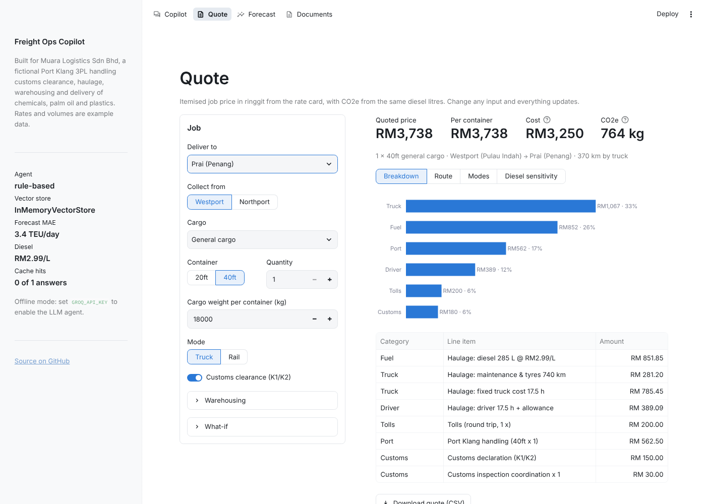
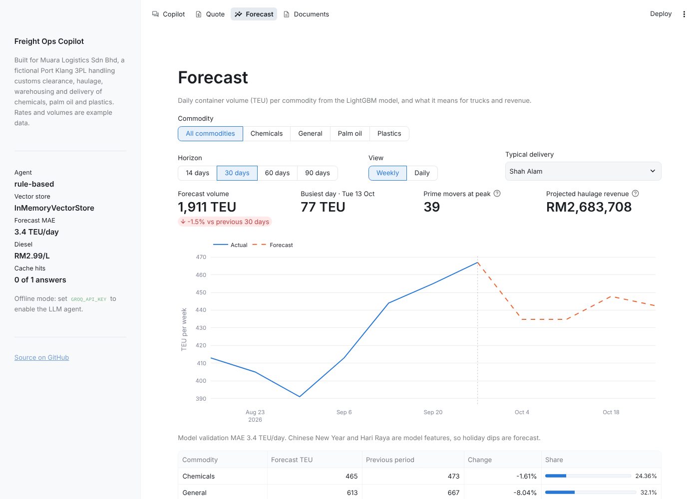
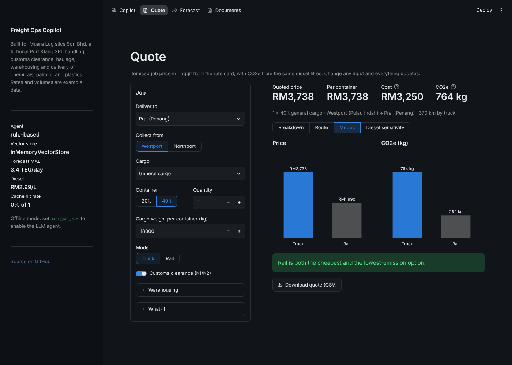
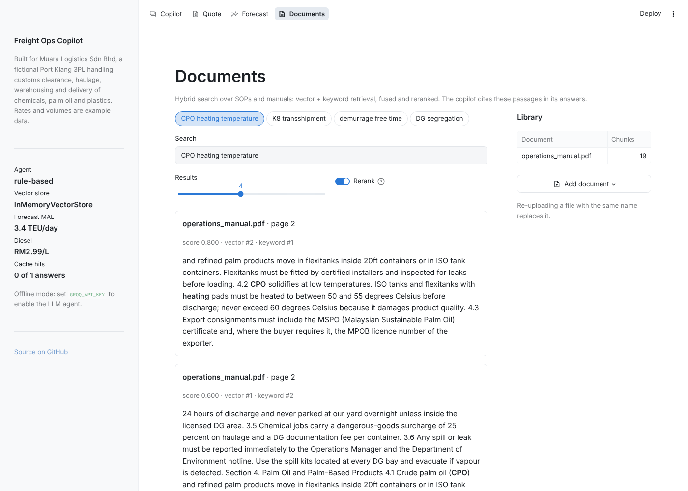
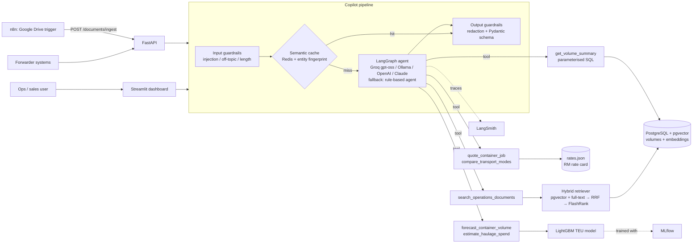

# 🚛 Freight Ops Copilot: AI for a Port Klang 3PL

[](https://supply-chain-ai-copilot-rul.streamlit.app/)
[](https://github.com/kl2412018279-ux/supply-chain-ai-copilot/actions/workflows/ci.yml)


**🚀 [Live demo](https://supply-chain-ai-copilot-rul.streamlit.app/)**: try the copilot in your browser. The free host sleeps when idle, so the first load can take about 30 seconds.

An AI copilot for a **Malaysian third-party logistics (3PL) provider at Port Klang**: the kind of company that handles customs clearance, container haulage, warehousing and final delivery of **chemicals, palm oil and plastics** for international freight forwarders.

> **Case study, not a real company.** The copilot is built for *Muara Logistics Sdn Bhd*, a **fictional** company modelled on typical Port Klang ground-handling 3PLs. All volumes are synthetic, and all rates are clearly labelled examples, see [Rate card](#rate-card-rm). This is an independent portfolio project, not affiliated with any company.

| Quote builder | Volume forecast |
|---|---|
|  |  |
| **Truck vs rail (dark mode)** | **Operations manual search** |
|  |  |

## What it does

| Question an ops team asks | What the copilot does |
|---|---|
| *"Quote 2 × 40ft palm oil from Westport to Pasir Gudang"* | Builds an **itemised quote in RM**: diesel, truck maintenance, driver, tolls, Westports handling, customs (K1/K2), cargo surcharges, warehousing and margin. Shows **CO2e computed from the same diesel litres**. |
| *"Compare truck vs rail for chemicals to Penang"* | Prices every transport mode side by side and reports the **RM cost per tonne of CO2e avoided**. |
| *"How many palm oil containers next month?"* | **LightGBM TEU forecast** per commodity, with Chinese New Year and Hari Raya dips and the Sep–Nov palm-oil harvest peak. |
| *"What's our projected haulage spend for chemicals?"* | Forecast TEU × rate card → **projected cost, revenue, diesel and CO2e in RM**. |
| *"What documents do I need to clear a chemical import?"* | **Hybrid RAG** over the operations manual (customs forms, dangerous goods, palm oil, demurrage, warehousing), with page citations. |
| *"Ignore previous instructions…"* | 🛡️ Blocked by input guardrails before any tokens are spent. |

It runs **fully offline with no API key**. Without an LLM configured, a deterministic rule-based agent calls the same tools. It also falls back to that agent automatically if the LLM provider fails.

---

## Architecture



### Request flow

1. **Input guardrails** block prompt injection, jailbreaks, SQL keywords, secret fishing and off-topic questions in under 1 ms.
2. **Semantic cache.** A similar question is answered from Redis in milliseconds. A hit also requires the *entity fingerprint* to match (numbers, destinations, commodities, transport modes), so *"quote 40ft to Penang"* never returns the cached answer for *"quote 40ft to Ipoh"*.
3. **LangGraph agent.** An explicit `agent → tools → agent` state machine. The LLM picks tools, and the number of steps is capped.
4. **Output guardrails.** API keys, e-mails, DSNs and card numbers are redacted, and the answer is validated against a Pydantic schema. Tool calls and cited sources are returned as JSON.

---

## Rate card (RM)

Every quote is built bottom-up from [`data/reference/rates.json`](data/reference/rates.json). A planner can update the weekly diesel price or contract rates there without touching code. Each rate records where it came from:

| Rate | Example value | Source |
|---|---|---|
| Diesel (Peninsular) | RM2.99 / L | MOF weekly APM retail price, Feb 2026 (latest found) |
| Port handling 20ft / 40ft | RM375 / RM562.50 | Westports container tariff effective 1 Jan 2026 |
| Max gross weight on trailer | 25,000 kg | Association of Malaysian Hauliers limit at Port Klang (May 2025) |
| CO2 per litre diesel | 2.68 kg | Standard tank-to-wheel combustion factor |
| Fuel use, truck costs, driver, tolls, customs fees, surcharges, warehousing, rail/sea | see file | **Assumptions**: replace with real contract rates |

How a truck quote is calculated:
- **Fuel** = round-trip km (loaded out, empty back) × litres per km × diesel price.
- **Truck and driver** = km × maintenance rate + hours × (fixed cost + driver wage).
- **Fixed charges**: tolls, port handling, customs declaration and inspection.
- **Cargo surcharges**: 25% dangerous-goods surcharge for chemicals, palm-oil tank fee.
- **Warehousing** (DG storage at 1.8× the normal rate).
- **15% margin** on top of cost.
- **CO2e** = diesel litres × 2.68.

Sanity check: haulage alone from Westport to Shah Alam comes out at about RM557 cost (RM640 with margin). That is in line with the last published regulated rate of RM639 (RM533 haulage + tolls + fuel adjustment, MIDA, 2011).

---

## Production features

| # | Feature | Implementation |
|---|---|---|
| 1 | **Hybrid search + reranking** | pgvector HNSW and PostgreSQL full-text search (BM25 in memory), fused with Reciprocal Rank Fusion and reranked with a FlashRank cross-encoder. Exact codes like *K8* or *UN* numbers are still matched. `src/rag/` |
| 2 | **Observability & MLOps** | LangSmith traces every node, LLM call and tool call. `/metrics` reports p50/p95 latency, cache hit rate and guardrail blocks. MLflow logs every grid-search trial with MAE, RMSE, R² and MAPE. |
| 3 | **AI safety & guardrails** | Pydantic schemas for every tool argument and response, injection and off-topic filters, output redaction, no text-to-SQL. `src/guardrails/` |
| 4 | **Semantic caching** | Redis-backed (in-memory fallback), with TTL, entity fingerprinting, invalidation on document changes, and no caching of fallback answers. `src/cache/` |
| 5 | **Resilience** | If the LLM provider fails (retired model, outage, rate limit), the rule-based agent answers with the same tools. Every external dependency (Postgres, Redis, LLM, embedding model) is optional. |
| 6 | **Testing & CI/CD** | 120+ pytest tests: cost engine, forecasting, RAG, agents (including a scripted-LLM LangGraph test), API, a headless Streamlit test, and pgvector/Redis integration. GitHub Actions runs ruff → pytest (Python 3.10 and 3.12) → Docker build. |

---

## Results

**Container-volume forecast** (synthetic data, 56-day time-based holdout, `python -m src.forecasting.train --tune`):

| Model | MAE (TEU/day) | RMSE | R² |
|---|---|---|---|
| Seasonal naive (same weekday last week) | 4.43 | 5.52 | 0.417 |
| **LightGBM** (lags, rolling stats, calendar, holidays) | **3.23** | **4.24** | **0.656** |

That is **27% lower MAE** than the baseline. R² is moderate because daily counts of around 10 TEU are inherently noisy.

**Retrieval** (`python -m src.rag.evaluate`: 20 labelled questions over the operations manual):

| Method | hit@1 | hit@3 | MRR@3 |
|---|---|---|---|
| Dense only | 0.60 | 0.85 | 0.72 |
| Keyword only (BM25) | 0.75 | 1.00 | 0.87 |
| Hybrid (RRF) | 0.75 | 0.95 | 0.84 |
| **Hybrid + rerank** | **0.75** | **1.00** | **0.87** |

These numbers use the offline backends (hashing embedder, lexical reranker), which is what CI runs. Measure the real bge-small + FlashRank stack with `EMBEDDING_BACKEND=sentence-transformers RERANKER_BACKEND=flashrank make eval`.

---

## Quick start

### Option A: local Python (about 2 minutes)

```bash
git clone https://github.com/kl2412018279-ux/supply-chain-ai-copilot.git
cd supply-chain-ai-copilot
python -m venv .venv && source .venv/bin/activate   # Windows: .venv\Scripts\activate
pip install -r requirements.txt

cp .env.example .env            # optionally add a free GROQ_API_KEY
python -m src.forecasting.train --tune      # train the TEU model
streamlit run app.py                        # http://localhost:8501
```

### Option B: full stack with Docker

```bash
cp .env.example .env            # add GROQ_API_KEY (free at https://console.groq.com)
docker compose up -d --build
```

| Service | URL |
|---|---|
| Streamlit dashboard | http://localhost:8501 |
| FastAPI (Swagger UI) | http://localhost:8000/docs |
| n8n automation | http://localhost:5678 |
| MLflow UI (`docker compose --profile mlops up -d`) | http://localhost:5000 |

On first start the API trains the forecaster, loads the volumes into Postgres and indexes the documents in `data/raw/`.

### LLM providers (all have $0 options)

| `LLM_PROVIDER` | Key | Default model |
|---|---|---|
| `groq` (recommended, free tier) | `GROQ_API_KEY` | `openai/gpt-oss-120b` |
| `ollama` (fully local) | none, run `ollama pull llama3.1` | `llama3.1` |
| `openai` | `OPENAI_API_KEY` | `gpt-4o-mini` |
| `anthropic` | `ANTHROPIC_API_KEY` | `claude-haiku-5-5` |
| `none` | none | rule-based offline agent |

Override the model with `LLM_MODEL`. Providers retire models over time (Groq shut down `llama-3.3-70b-versatile` in August 2026). The copilot falls back to the rule-based agent if the LLM call fails.

---

## REST API

| Method | Endpoint | Purpose |
|---|---|---|
| `POST` | `/chat` | Copilot answer + tool calls + sources (guardrails and cache applied) |
| `POST` | `/quote` | Itemised RM quote + CO2e for a container job |
| `POST` | `/quote/compare` | Every transport mode for a destination, with RM per tonne CO2e avoided |
| `GET` | `/destinations`, `/rates` | Destinations served and the full rate card |
| `POST` | `/forecast` | `{commodity, horizon_days}` → daily TEU forecast |
| `GET` | `/commodities` | Commodities known to the model |
| `GET` | `/volumes/summary` | `?commodity=&start_date=&end_date=` historical TEU |
| `POST` | `/documents/ingest` | Upload a PDF/TXT/MD (used by n8n) |
| `POST` | `/documents/search` | Hybrid search with optional rerank |
| `GET` / `DELETE` | `/documents`, `/documents/{source}` | List / remove documents |
| `POST` | `/emissions` | Generic tonne-km CO2e for any shipment |
| `GET` | `/health`, `/metrics` | Liveness, latency percentiles, cache hit rate |

```bash
curl -s localhost:8000/quote -H 'content-type: application/json' \
  -d '{"destination": "Penang", "container_size": "40", "cargo_type": "chemicals"}' | jq
```

**n8n:** import `n8n/drive_to_copilot_ingest.json`, connect Google Drive and set the folder. Every SOP or manual dropped into that folder is indexed automatically.

---

## Data

- **`data/raw/container_volumes.csv`**: synthetic daily TEU per commodity (chemicals, palm oil, plastics, general), January 2024 to September 2026. It includes weekday patterns, holiday dips, the palm-oil harvest peak, year-end peaks and growth. Regenerate it with `python -m src.forecasting.data`. Real exports work too: any CSV with a date, a commodity/series column and a TEU/volume column.
- **`data/raw/operations_manual.pdf`**: a **fictional** 10-section operations manual covering customs (K1/K2/K8, uCustoms), dangerous goods, palm oil (heating, MSPO, EUDR), plastics, haulage, demurrage/detention, warehousing, pricing and ESG. It is generated from `scripts/sample_docs/operations_manual.md`. Its rules are simplified examples, so verify real requirements with JKDM and the port operators.
- **`data/reference/rates.json`**: the rate card described above.

## Development

```bash
pip install -r requirements-ci.txt   # lightweight: no torch / LLM SDKs
make lint                             # ruff check + format check
make test                             # all unit tests, no services needed
docker compose up -d postgres redis && make test-all   # + pgvector/Redis integration tests
```

## Deploying the demo for free

- **Streamlit Community Cloud.** Use main file `app.py` with Python 3.11 or 3.12. `packages.txt` installs LightGBM's OpenMP runtime. Add these secrets:

  ```toml
  GROQ_API_KEY = "gsk_..."
  EMBEDDING_BACKEND = "hashing"   # keeps memory under the free 1 GB limit
  RERANKER_BACKEND = "lexical"
  ```
- **Hugging Face Spaces.** Use a Docker Space with the command `streamlit run app.py --server.port 7860 --server.address 0.0.0.0`.
- **Supabase** (free Postgres with pgvector). Set `DATABASE_URL`.

## Project structure

```
supply-chain-ai-copilot/
├── app.py                       # Streamlit entry: sidebar + top navigation
├── views/                       # pages: copilot, quote, forecast, documents (+ shared chart style)
├── .streamlit/config.toml       # light/dark theme
├── data/
│   ├── raw/                     # container_volumes.csv, operations_manual.pdf
│   └── reference/rates.json     # RM rate card (example values + sources)
├── src/
│   ├── costing/                 # rate card loader, quote engine, mode comparison
│   ├── forecasting/             # TEU data/features, train (MLflow), predict, volume repo, CO2 calc
│   ├── rag/                     # ingestion, embeddings, pgvector store, reranker, retriever, eval
│   ├── agent/                   # tools, LangGraph workflow + rule-based agent, copilot pipeline
│   ├── guardrails/              # input checks, redaction, response schemas
│   ├── cache/                   # semantic cache (Redis / memory)
│   ├── api/main.py              # FastAPI
│   ├── config.py, observability.py
├── notebooks/                   # 01 volume exploration, 02 training + RM projection
├── docker/, docker-compose.yml, Dockerfile, n8n/, scripts/
└── tests/                       # pytest suite (120+ tests)
```

## Roadmap

**Phase 2 (planned):**
- **Demurrage & detention alerts**: flag containers close to free-time expiry, with the RM penalty at risk.
- **Fleet maintenance tracker**: cost per km per prime mover, plus service-due alerts.
- **Warehouse occupancy forecast** for the general and DG stores.
- **n8n rate-request automation**: a forwarder's rate-request e-mail produces a draft quote automatically.

**Known limitations:**
- Rates are examples; distances and tolls are approximate.
- The forecast is a point estimate. Quantile regression would add prediction intervals for capacity buffers.
- The semantic cache scans entries linearly; use a RediSearch vector index at scale.
- Guardrails are deterministic rules. Add NeMo Guardrails or an LLM judge to check that answers are grounded in their sources.
